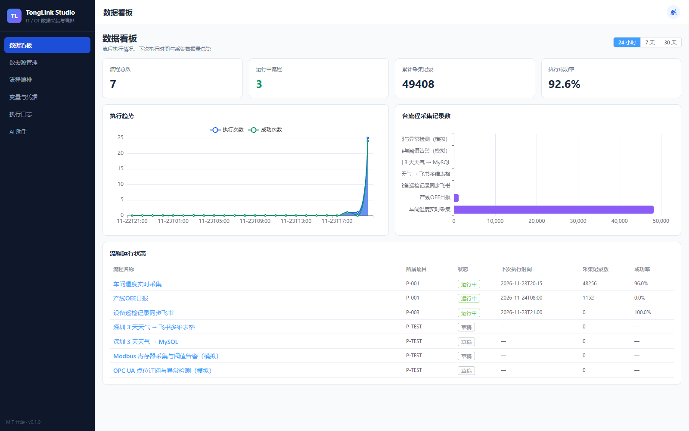
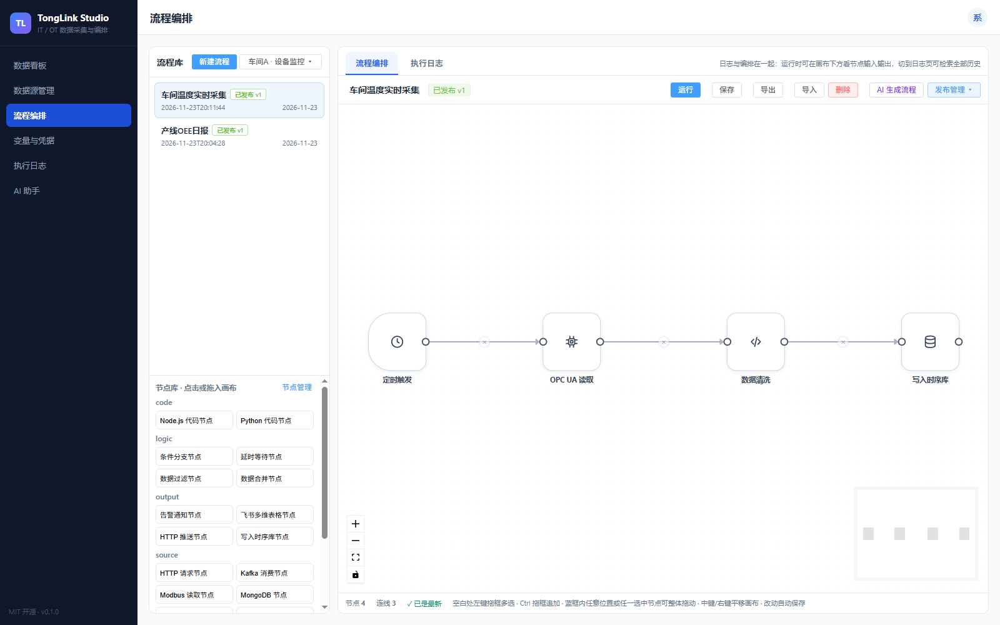
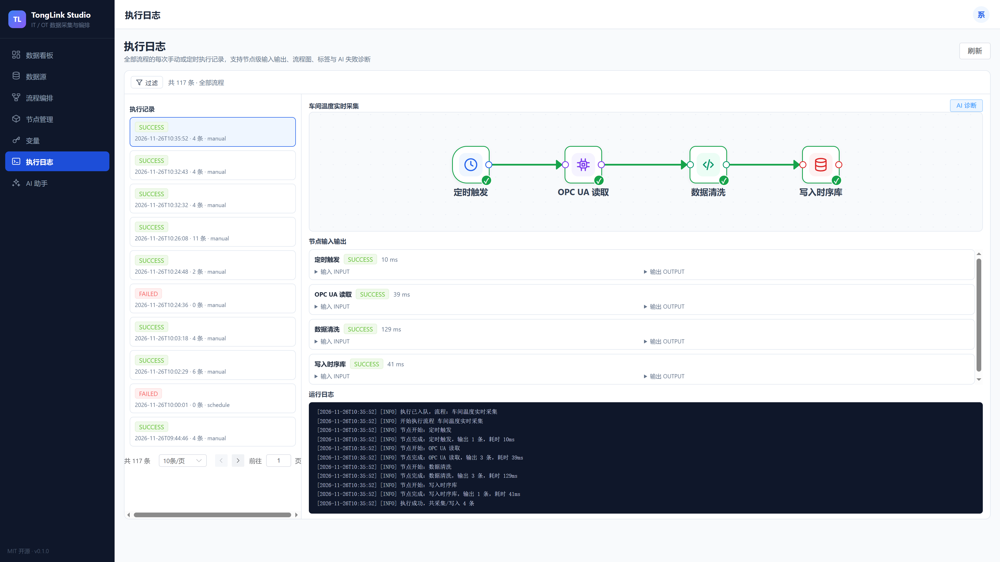
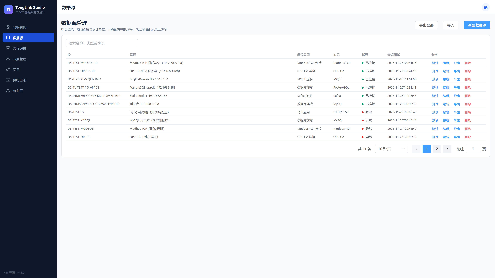
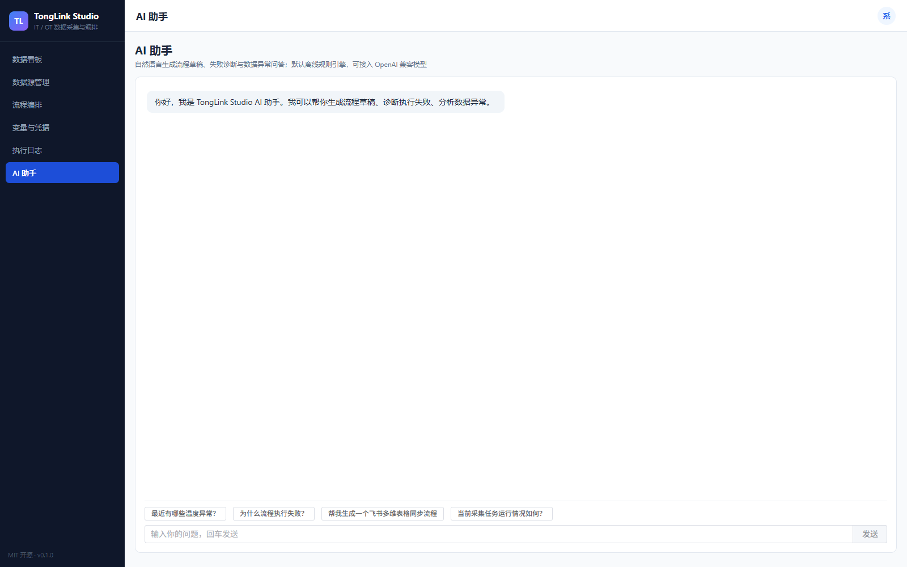
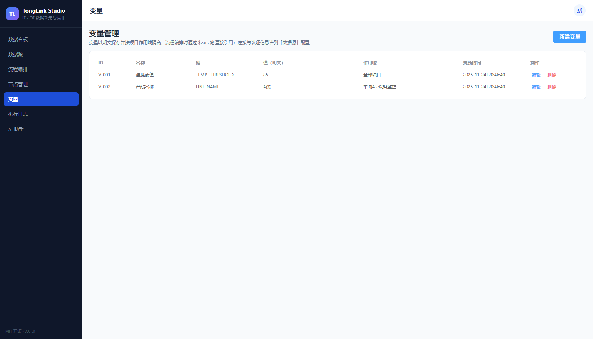

# TongLink Studio

<div align="center">

**通通都能连接 —— 开源 IT/OT 数据采集与编排平台**

一个面向工业现场的数据流编排工具：用可视化 DAG 连接 OPC UA、Modbus、MQTT、HTTP、数据库与飞书多维表格，让数据从设备到业务系统顺畅流动。

[](LICENSE)
[](https://openjdk.org/)
[](https://spring.io/projects/spring-boot)
[](https://vuejs.org/)

</div>

## 界面预览

| 数据看板 | 流程编排（DAG 画布） |
|:---:|:---:|
|  |  |

| 执行日志与节点诊断 | 数据源管理 |
|:---:|:---:|
|  |  |

| AI 助手 | 变量与凭据 |
|:---:|:---:|
|  |  |

## 功能特性

- **可视化流程编排**：基于 `@vue-flow/core` 的 DAG 画布，支持节点拖拽、框选多选、连线、平移缩放；定时 / 手动触发。
- **丰富的节点**：定时触发、OPC UA / Modbus / MQTT 采集、HTTP 请求、Node.js / Python 代码节点、条件分支、数据清洗、飞书多维表格、MySQL / PostgreSQL / Oracle / MongoDB 写入等。
- **发布与版本管理**：草稿与已发布图隔离，发布生成不可变版本快照，支持版本时间线与一键回滚；未发布流程禁止下线。
- **执行与可观测性**：DAG 拓扑执行，节点级输入 / 输出与耗时记录，服务端分页的执行日志、标签过滤、AI 失败诊断，WebSocket 实时状态推送。
- **数据源 / 凭据 / 变量**：统一管理连接配置，凭据使用 AES-GCM 加密存储，变量支持项目级作用域。
- **AI 助手**：默认本地规则引擎即可生成流程草稿、诊断执行失败、分析数据异常；可配置 OpenAI 兼容接口切换外部模型。
- **双数据库持久化**：SQLite 开箱即用，也可切换 PostgreSQL 支撑团队与高并发场景；同一份 jar 靠 `DB_URL` 自动选择驱动，表结构与 SQL 双库通用。
- **全中文界面**：面向国内工业现场，菜单、提示、日志与文档均为中文。

## 快速开始

### 环境要求

- JDK 21+
- Maven 3.9+
- Node.js 20+

### 后端

```bash
cd backend
mvn -DskipTests clean package
cd tonglink-app
java -jar target/tonglink-studio.jar
```

后端默认监听 `http://localhost:8080`，首次启动会自动创建 SQLite 数据库（`./data/tonglink.db`）并初始化内置账号与测试项目。

**切换到 PostgreSQL**（同一份 jar，无需重新打包）——只需设置数据库连接环境变量：

```bash
DB_URL="jdbc:postgresql://localhost:5432/tonglink" DB_USER=tonglink DB_PASSWORD=你的密码 \
  java -jar target/tonglink-studio.jar
```

Spring Boot 会依据 `DB_URL` 前缀自动选择 PostgreSQL 驱动，首次启动自动建表（15 张，与 SQLite 通用）。容器编排见 `docker/docker-compose.postgres.yml`，完整说明见 [`DEPLOYMENT.md`](docs/DEPLOYMENT.md) 第 5 节。

### 前端

```bash
cd frontend
npm install
npm run dev
```

浏览器打开 `http://localhost:5173`，使用内置账号登录：

| 账号 | 密码 | 角色 |
|---|---|---|
| admin | Admin@123 | 系统管理员 |
| engineer | Eng@123 | 工程师 |
| viewer | View@123 | 只读用户 |

> 生产环境请通过环境变量覆盖默认密钥（`TONGLINK_CRYPTO_KEY`、`TONGLINK_JWT_SECRET`），并修改内置账号口令。详见 [`docs/DEPLOYMENT.md`](docs/DEPLOYMENT.md)。

### 免构建原型

不想启动前后端？双击 `prototype/index.html` 即可体验完整的交互原型，无需任何依赖。

## 项目结构

```
tonglink/
├── backend/           # Spring Boot 后端（14 个 Maven 模块）
│   ├── tonglink-common/       公共工具
│   ├── tonglink-model/        领域模型
│   ├── tonglink-repository/   持久化（SQLite / PostgreSQL）
│   ├── tonglink-security/     认证、JWT、加密
│   ├── tonglink-datasource/   数据源管理
│   ├── tonglink-node/         节点定义与注册表
│   ├── tonglink-workflow/     流程与项目、发布版本
│   ├── tonglink-connector/    各类节点执行器
│   ├── tonglink-queue/        执行队列（内存 / Redis）
│   ├── tonglink-taskrunner/   代码节点运行器
│   ├── tonglink-execution/    执行引擎与看板
│   ├── tonglink-scheduler/    定时调度
│   ├── tonglink-ai/           AI 助手
│   └── tonglink-app/          启动入口与初始化
├── frontend/          # Vue 3 + TypeScript + Element Plus
├── prototype/         # 零依赖交互原型（直接打开 HTML）
├── docs/              # 架构、部署、开发与截图
├── docker/            # Dockerfile 与 compose
├── scripts/           # 构建与部署脚本
└── TEST_REPORT.md     # 自动化测试报告
```

## 文档

- [项目介绍](docs/INTRODUCTION.md) — 功能清单、核心概念、与 n8n 的关系
- [架构设计](docs/ARCHITECTURE.md) — 前后端架构、执行引擎、节点插件、安全设计
- [部署指南](docs/DEPLOYMENT.md) — 单容器轻量 / 标准 / 队列模式
- [开发指南](docs/DEVELOPMENT.md) — IDEA / VS Code 导入、本地运行、测试
- [测试报告](TEST_REPORT.md) — 自动化测试与回归记录

## 测试

```bash
# 后端单元测试
cd backend && mvn test

# 前端单元测试
cd frontend && npm test
```

## 技术栈

Java 21 · Spring Boot 3.5 · SQLite / PostgreSQL · JdbcTemplate · JWT · AES-GCM · Vue 3 · Vite 6 · TypeScript · Element Plus · @vue-flow/core · ECharts

## 开源协议

本项目采用 [MIT License](LICENSE)。界面范式参考 n8n / Node-RED 等开源项目，但代码与品牌完全独立；画布使用同样 MIT 协议的 `@vue-flow/core`。
