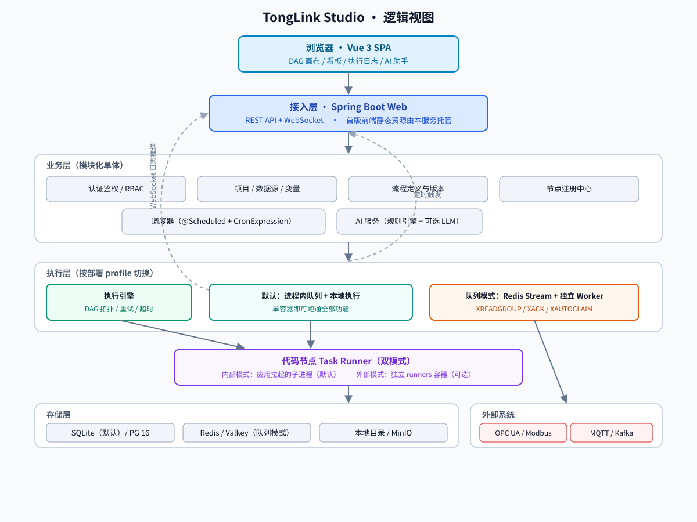
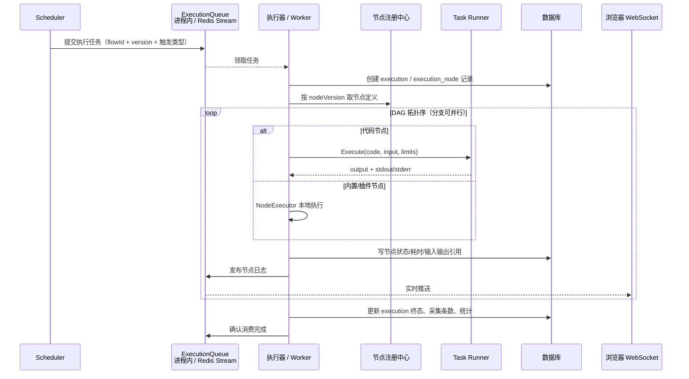

# TongLink Studio 架构设计（v0.2）

> 本文是把交互原型落地为开源工程的设计基线。原型里已确定的契约（项目 → 流程两级、DAG 画布、Schema 驱动属性面板、类型驱动的数据源表单、节点可安装）在本文中被保留并升级为前后端共享的正式契约。
>
> 本版依据 9 项关键决策修订，并参考业界常见做法重新设计了代码节点运行与容器部署形态。项目介绍见 [`INTRODUCTION.md`](INTRODUCTION.md)，部署操作见 [`DEPLOYMENT.md`](DEPLOYMENT.md)。

---

## 0. 范围与原则

### 0.1 目标

- 一个可自我托管的 IT/OT 数据采集与编排平台，MIT 协议开源，代码发布到 GitHub。
- 用户用 DAG 编排采集链路：触发器 → 数据源/逻辑/代码节点 → 输出节点。
- 每次手动或定时执行都有完整日志、节点级耗时与采集条数统计。
- 节点可独立开发、安装、升级，前端无需改代码即可出现新节点。
- 具备 AI 能力：自然语言生成流程、失败诊断、数据异常问答。
- **首版即交付上述全部功能**，不做功能阉割的「演示版」。

### 0.2 非目标

- 不做多租户 SaaS 计费、不做公开市场账号体系。
- 不做分布式事务；采用「至少一次 + 幂等」语义并在文档中明示。
- 不承诺对所有恶意代码实现绝对隔离（见第 7 节边界说明）。
- 不做流处理引擎（Flink 等）；连续订阅场景先用长驻流程 + 缓冲实现。
- 不复制第三方项目的代码与品牌；本项目只借鉴通用交互范式与架构思路，所有依赖保持与本项目兼容的开源许可。

### 0.3 架构原则

1. **契约先行**：`流程 JSON` 与 `节点定义 Schema` 是前后端、插件之间的唯一契约，原型中的 `Proto.NODE_SCHEMAS` 直接演进为后端下发的 `NodeDefinition.configSchema`。
2. **渐进式复杂度**：默认单容器、进程内执行即可跑通全部功能；需要扩展时再把数据库、队列、Worker、Runner 逐层拆出去。**架构支持拆分，但部署不强制拆分**。
3. **模块化单体 + 可选独立 Worker**：业务模块在一个 Spring Boot 代码库内分模块；Worker 与 Task Runner 是同一份代码的不同运行 profile。
4. **插件化一切节点**：内置节点与第三方节点走同一套注册契约，消灭「加节点要改前端」的问题。
5. **全中文注释**：所有代码注释、Javadoc、JSDoc 使用中文，降低国内贡献者阅读与维护成本。
6. **可观测优先**：执行链路从第一天就带 traceId、结构化日志与节点级指标。

---

## 1. 总体架构

### 1.1 逻辑视图



> 矢量图，放大不失真。分层展示浏览器、接入层、业务层（模块化单体）、执行层、Task Runner、存储层及外部系统之间的关系；实线为调用链，虚线为 WebSocket 日志推送与定时触发。

### 1.2 部署视图（渐进容器数）

容器数量**取决于部署方式，而不是固定的**。同一套镜像通过环境变量切换 profile：

| 形态 | 容器数 | 组成 | 适用场景 |
|---|---|---|---|
| **轻量模式 lite** | **1** | `app`（Spring Boot 同时托管前端静态资源、SQLite 内嵌库、进程内队列、内部 Runner 子进程） | 试玩、开发、跑简单工作流；一条 `docker run` 启动 |
| **标准模式 standard** | **2** | `app` + `postgres:16-alpine` | 团队长期使用、执行记录较多；避免 SQLite 并发写瓶颈 |
| **队列模式 queue** | **4+** | `app-web` + `app-worker` × N + `postgres` + `redis`；可选 `runners`、`nginx`、监控 | 高并发、需要水平扩展 Worker、需要独立代码沙箱 |
| **Kubernetes** | 弹性 | 队列模式的容器化编排，Worker 按队列深度 HPA | 大规模生产 |

说明：

- 轻量模式使用 SQLite，标准/队列模式使用 PostgreSQL（可叠加 TimescaleDB）。**实际实现**：同一份 jar 内含两套 JDBC 驱动，由 `DB_URL` 前缀自动选择；Repository 层用 JdbcTemplate 手写通用 SQL 屏蔽方言差异，建表由 `schema.sql`（通用 DDL）完成，结构变更按最新脚本重建数据库，不做旧库补列迁移。TimescaleDB hypertable / 连续聚合属于可选增强，非必需；标准模式用原生 PostgreSQL 16 即可运行。
- 轻量/标准模式不需要 Redis：执行队列是进程内的 `ExecutionQueue` 实现；只有队列模式才启用 Redis Stream 版本。
- Task Runner 默认是应用拉起的**子进程**（内部模式），因此单容器即可执行 Node.js/Python 代码；只有需要更强隔离时才启用外部 `runners` 容器（外部模式）。
- 从轻量模式切换到标准模式按 `schema.sql` 新建 PostgreSQL 库、导入数据并设置 `DB_URL`；不提供旧库结构升级迁移，数据库驱动依据 URL 前缀自动切换。

### 1.3 技术栈总表

| 层次 | 选型 | 版本基线 | 许可证 | 理由 |
|---|---|---|---|---|
| 前端框架 | Vue 3 + TypeScript | 3.5+ | MIT | 组合式 API 适合复杂画布，生态成熟 |
| 构建 | Vite 6 + npm | Vite 6.x / npm 10+ | MIT | 启动快、构建产物可直接由 Spring Boot 托管；仓库用 `package-lock.json` 锁定版本 |
| DAG 画布 | **`@vue-flow/core` 及配套包** | **1.48.x** | MIT | 成熟的 DAG 画布库（`@vue-flow/core` / `background` / `controls` / `minimap` / `node-resizer`）；上游仓库已归档但版本稳定，锁定版本使用，后续可平滑迁移到 `@xyflow/vue` |
| 代码编辑 | 原生 textarea（ElInput） | - | MIT（Element Plus） | Node.js / Python 代码以纯文本编辑为主，零额外编辑器依赖 |
| UI 组件 | Element Plus | 2.x | MIT | 表单/抽屉/表格齐全，Schema 表单好映射 |
| 图表 | ECharts | 5.x | Apache-2.0 | 看板趋势/柱状/异常标记 |
| 状态 | Pinia + Vue Router | 最新 | MIT | 类型友好的状态与路由守卫 |
| 后端 | **Spring Boot 3.5.x + Java 21 LTS** | 3.5 / 21 | Apache-2.0 | 3.x 最新稳定文档版；Java 21 兼容性与生态最稳 |
| 持久层 | Spring Boot JDBC（JdbcTemplate）+ HikariCP | Spring Boot 3.5 内置 | Apache-2.0 | 手写通用 SQL 屏蔽 SQLite / PostgreSQL 方言差异，无 ORM、无迁移工具 |
| 主库 | SQLite（默认）/ PostgreSQL 16（标准） | 3.49 / 16 | 公有领域 / PostgreSQL | 同一 jar 含双驱动，按 `DB_URL` 前缀切换；`schema.sql` 建表，流程 JSON 以 TEXT 存储 |
| 队列 | 进程内队列（默认）/ Redis Streams（队列模式） | Lettuce 6.5 / Redis 7+ | BSD / 视版本 | 默认零依赖，队列模式用消费组 + `XAUTOCLAIM` 接管超时消息 |
| 调度 | `@Scheduled` + `CronExpression` 轻量调度 | Spring Boot 3.5 内置 | Apache-2.0 | 每 5s tick 扫描 `next_run`，秒/分/Cron 统一换算；单实例足够，不引入 Quartz |
| 安全 | Spring Security + JWT + AES-GCM | - | Apache-2.0 | 无状态 API，数据源密码字段 AES-GCM 加密 |
| AI | 本地规则引擎 + 可选 OpenAI 兼容接口 | - | 本项目 MIT | 默认离线可用；在「设置 → AI 模型」页配置后走真实 LLM，基于 JDK HttpClient |
| 可观测 | Spring Boot Actuator（health/info/metrics） | Spring Boot 3.5 内置 | Apache-2.0 | 提供健康检查与基础指标；OTel 链路追踪、Prometheus/Grafana 属可选增强 |
| 文档 | springdoc-openapi | 2.x | Apache-2.0 | 自动生成 API 文档 |
| 测试 | Vitest / JUnit 5 + 环境变量门控真机测试 | - | MIT / Apache-2.0 | 前端单测 + 后端集成测试；Kafka/MQTT/PG/Redis/Modbus/OPC UA 用真机联调，不用 Testcontainers |

---

## 2. 前端架构

### 2.1 目录结构

```
frontend/
├─ package.json / package-lock.json / vite.config.ts / tsconfig.json
├─ src/
│  ├─ main.ts / App.vue
│  ├─ router/index.ts                 # 路由 + 登录守卫 + 项目上下文
│  ├─ api/
│  │  ├─ request.ts                   # 统一请求、错误码、token 刷新
│  │  └─ modules/{auth,project,source,variable,flow,node,execution,ai}.ts
│  ├─ stores/{auth,project,source,flow,execution,ai}.ts
│  ├─ types/{api,flow,node,schema,execution}.ts
│  ├─ composables/
│  │  ├─ useSchemaForm.ts             # Schema → 表单模型 + 联动 + 校验
│  │  ├─ useFlowGraph.ts              # 流程 JSON ↔ 画布节点/边
│  │  └─ useExecutionSocket.ts        # WebSocket 日志订阅
│  ├─ components/
│  │  ├─ common/                      # 按钮/抽屉/表格/状态徽标
│  │  ├─ flow/
│  │  │  ├─ FlowCanvas.vue            # @vue-flow/core 封装
│  │  │  ├─ FlowNode.vue              # 自定义节点（含状态灯）
│  │  │  ├─ NodePalette.vue           # 节点库 + 节点管理入口
│  │  │  ├─ NodeConfigDrawer.vue      # 双击节点打开
│  │  │  ├─ SchemaForm.vue            # 递归渲染字段
│  │  │  └─ fields/                   # DatasourceField / CredentialField / CodeField ...
│  │  └─ ai/AiPanel.vue
│  └─ views/{Login,Dashboard,Sources,Flows,Variables,Executions,Ai}.vue
```

### 2.2 关键设计

**a. Schema 驱动的属性面板（对应原型的核心契约）**

后端 `GET /api/v1/nodes/definitions` 返回全部已安装节点的 `NodeDefinition`，前端按 `configSchema.fields[].type` 渲染组件：

| Schema type | 渲染组件 | 说明 |
|---|---|---|
| `text` / `textarea` / `number` | ElInput / ElInputNumber | 带 placeholder、required、hint |
| `select` | ElSelect | options 来自 Schema，支持 `showWhen` 联动 |
| `datasource` | ElSelect | 拉取 `GET /datasources`；连接类字段按节点协议过滤，认证类字段列出全部数据源。数据源本身由类型决定类别与协议，不再让用户重复填写 |
| `credential` | ElSelect | 已并入 `datasource`；节点定义中不再出现该类型 |
| `secret` | ElInput(type=password) | 仅本地编辑，提交后后端加密，永不回显明文 |
| `code` | ElInput(textarea) | Node.js / Python 代码原生文本编辑 |
| `json` | JSON 编辑器 | 字段映射等结构化配置 |
| `boolean` | ElSwitch | |
| `showWhen` | - | `{ key, in: [...] }`，例如数据库节点选 `insert` 才显示写入值 |

前端用 AJV 做提交前校验，后端用同一份 Schema（JSON Schema 子集）做服务端校验，**双端规则一致**。新增节点只需后端装包，前端节点库与表单自动出现。

**b. DAG 画布**

- 基于 **`@vue-flow/core` 1.48.x** 及 `background` / `controls` / `minimap` / `node-resizer` 配套包；自定义节点组件、自定义贝塞尔边。
- 交互与原型保持一致：**单击选中并可拖动，双击打开属性配置**，Delete 删除，拖拽端口连线，滚轮缩放。
- 保存时把 `nodes[]`（id/type/subtype/position/config）与 `edges[]`（id/source/target/sourceHandle/targetHandle）序列化为流程 JSON。
- 连线前做环检测（拓扑排序），有环则拒绝并提示；流程发布时后端再校验一次。
- 撤销/重做用快照栈（限制 50 步）。

**c. 状态与权限**

- Pinia：`auth`（用户/角色/权限）、`project`（当前项目，持久化到 localStorage）、`flow`（当前流程草稿与脏标记）、`execution`（运行中状态）。
- 路由守卫：系统只有 `admin` 一个内置账号，拥有编排、运行与配置全部权限；未登录统一跳转登录页。
- 顶部项目下拉是全局上下文：数据源、流程、看板都按当前项目过滤（与原型一致）。

**d. 实时日志**

执行详情页通过 WebSocket 订阅 `/ws/executions/{executionId}`。轻量/标准模式下由进程内事件总线推送，队列模式下由 Worker 发布 Redis Pub/Sub、Web 层转发。断线时退化为轮询 `GET /executions/{id}/logs?after=seq`，保证不丢日志。

**e. AI 入口**

独立 AI 页面 + 流程编排/执行日志/看板三处嵌入面板。生成流程时后端返回**结构化流程 JSON**（不是纯文本），前端先加载为草稿并动画展示，用户确认后才可保存/发布，杜绝 AI 直接改生产流程。

---

## 3. 后端架构

### 3.1 模块划分（Maven 多模块）

```
backend/
├─ pom.xml                            # 父 POM，依赖版本统一管理
├─ tonglink-common/                   # Result/异常/工具/常量/Schema 定义
├─ tonglink-security/                 # 登录、JWT、RBAC、加解密服务
├─ tonglink-model/                    # 实体、DTO、枚举、领域接口
├─ tonglink-repository/               # Mapper / SQL / 存储抽象（PostgreSQL / SQLite）
├─ tonglink-datasource/               # 数据源 CRUD、连通性测试、协议元数据
├─ tonglink-workflow/                 # 项目、流程定义、版本、导入导出
├─ tonglink-node/                     # 节点注册中心、插件安装/卸载、Schema 管理
├─ tonglink-scheduler/                # 轻量 @Scheduled 定时调度、触发模式转换
├─ tonglink-queue/                    # ExecutionQueue 抽象：进程内实现 / Redis Stream 实现
├─ tonglink-execution/                # DAG 执行、日志、统计、Worker profile
├─ tonglink-taskrunner/               # Task Runner 管理：内部子进程 / 外部容器 Broker
├─ tonglink-connector/                # OT/IT 协议驱动适配器
├─ tonglink-ai/                       # LLM 工具、Prompt、诊断与生成
└─ tonglink-app/                      # 启动装配；profiles: lite / standard / web / worker / queue
```

每个模块一个 `README.md`（中文），写清职责、对外接口、禁止依赖方向。依赖方向严格单向：
`app → 业务模块 → repository/queue/taskrunner → model → common`，`security` 被所有业务模块依赖，`node` 被 `workflow`/`execution` 依赖。

### 3.2 分层

每个业务模块内部统一四层：

| 层 | 职责 | 命名 |
|---|---|---|
| 接口层 | HTTP 入参校验、权限注解、DTO 转换 | `XxxController` |
| 应用层 | 用例编排、事务边界、领域事件发布 | `XxxApplicationService` |
| 领域层 | 实体、值对象、业务规则（如 DAG 校验） | `XxxDomainService` / `model/` |
| 基础设施层 | 数据库、队列、外部系统调用 | `repository/` / `gateway/` |

**不把业务逻辑写进 Controller**，也不让领域层依赖 Spring 注解以外的框架细节。

### 3.3 核心 API（REST /api/v1）

| 方法 | 路径 | 说明 |
|---|---|---|
| POST | `/auth/login` `/auth/refresh` `/auth/logout` | 登录、刷新、退出 |
| GET/POST/PUT/DELETE | `/projects` | 项目管理 |
| GET/POST/PUT/DELETE | `/datasources` | 数据源（一张类型表单同时填连接与认证）；`POST /datasources/test` 保存前测试（编辑态传 `id` 时用已保存的解密密码替换掩码）、`POST /datasources/{id}/test` 测试已保存数据源；单条/全部导出 |
| GET | `/datasources/credential-types` | 连接/认证类型目录，含字段定义、类别与协议；前端据此渲染唯一一张表单 |
| GET/POST/PUT/DELETE | `/variables` | 变量（明文、按项目隔离，无历史密文兼容） |
| GET/POST/PUT/DELETE | `/flows` | 流程；`POST /flows/{id}/publish` 发布版本；`POST /flows/import` 导入 |
| GET | `/nodes/definitions` | **已安装节点定义 + Schema**（前端节点库与表单的数据源） |
| POST/DELETE | `/nodes/install` `/nodes/{packageId}` `/nodes/packages` | 安装/卸载节点包、查看已安装包与运行时 |
| POST | `/flows/{id}/run` | 手动执行；返回 executionId |
| GET | `/executions` `/executions/{id}` `/executions/{id}/logs` | 执行列表、详情、日志 |
| GET | `/dashboard/summary` `/dashboard/trend` | 看板聚合 |
| POST | `/ai/generate-flow` `/ai/diagnose` `/ai/ask` | AI 能力 |

统一响应 `Result<T>{ code, message, data, traceId }`；列表使用游标分页；所有写接口支持 `Idempotency-Key`。

---

## 4. 数据模型

### 4.1 表清单

| 表 | 关键字段 | 说明 |
|---|---|---|
| `sys_user` / `sys_role` / `sys_user_role` | id, username, password_hash, role | 内置账号，BCrypt |
| `project` | id, name, code, color, description | 项目分类 |
| `datasource` | id, name, category(IT/OT), protocol, config_json, credential_type, credential_json, status | `credential_type` 唯一决定类别与协议；连接与认证参数同在 `credential_json`，密码字段 AES-GCM 加密；`config_json` 只放节点专用附加参数 |
| `variable` | id, name, key, env, value_cipher, scope | 明文直接存 `value_cipher` 字段（无前缀、无解密兼容）；scope 为 `all` 或逗号分隔的项目 ID |
| `flow_definition` | id, project_id, name, draft_graph, published_version, status | 草稿与当前发布版本分离 |
| `flow_version` | id, flow_id, version, graph_json, changelog | 不可变快照，执行时锁定版本 |
| `node_package` | id, package_id, version, manifest_json, file_path, status, installed_at | 插件安装记录，支持多版本并存 |
| `execution` | id, flow_id, flow_version, trigger_type, status, start/end_time, records, error_summary, idempotency_key | 每次运行一条 |
| `execution_node` | id, execution_id, node_id, node_type, node_version, status, duration_ms, input_ref, output_ref, retry_count | 节点级状态与耗时 |
| `execution_log` | id, execution_id, node_id, seq, level, message, ts | SQLite / PostgreSQL 下均为普通表（通用 DDL） |
| `metric_point` | ts, flow_id, node_id, tags, values | 采集数据样本，同上 |
| `ai_conversation` / `ai_message` | id, user_id, role, content_json, created_at | AI 会话历史 |
| `audit_log` | id, actor, action, target, ip, ts | 安全审计 |

### 4.2 关键约定

- 流程定义用 TEXT 字段整体存储 JSON 字符串（`graph_json` / `published_graph_json`），结构见第 5 节；避免为节点配置建几十张表。SQLite 与 PostgreSQL 通用 DDL，实体层做 JSON 序列化/反序列化。
- 执行输入/输出超过 64KB 时写入 MinIO（或轻量模式的本地目录），`execution_node` 只存引用；小数据直接内联。
- `execution_log` 与 `metric_point` 在两种库下均为普通表 + 时间索引，按保留策略定时清理；TimescaleDB hypertable 与连续聚合属可选增强，当前未启用。
- 所有表带 `created_at` / `updated_at`，主键用 `varchar(32)` 的 ULID（前端友好、可排序）。

---

## 5. 流程与节点契约（前后端 + 插件共享）

### 5.1 流程 JSON

直接沿用原型的结构，增加版本与设置：

```json
{
  "schemaVersion": 1,
  "id": "flow-1",
  "name": "车间温度实时采集",
  "projectId": "P-001",
  "settings": { "maxConcurrency": 1, "overlapPolicy": "SKIP", "timeoutSeconds": 300 },
  "nodes": [
    {
      "id": "n11",
      "type": "trigger",
      "subtype": "schedule",
      "nodeVersion": 1,
      "title": "定时触发",
      "position": { "x": 60, "y": 170 },
      "config": { "mode": "minutes", "interval": 5, "timezone": "Asia/Shanghai" }
    },
    {
      "id": "n13",
      "type": "source",
      "subtype": "opcua",
      "nodeVersion": 1,
      "title": "OPC UA 读取",
      "position": { "x": 350, "y": 230 },
      "config": { "datasource": "DS-001", "nodeId": "ns=3;s=Temperature.PT101", "qualityFilter": "GOOD_ONLY" }
    }
  ],
  "connections": [
    { "id": "e11", "source": "n11", "target": "n13", "sourceHandle": "out", "targetHandle": "in" }
  ]
}
```

### 5.2 节点定义（NodeDefinition）

由节点包提供，后端注册中心加载后原样下发前端：

```json
{
  "type": "source",
  "subtype": "mysql",
  "title": "MySQL 查询",
  "icon": "database",
  "category": "数据源",
  "runtime": "java",
  "nodeVersion": 1,
  "minPlatformVersion": "0.1.0",
  "configSchema": {
    "title": "MySQL 查询",
    "note": "支持 select / insert / update / delete / execute",
    "fields": [
      { "key": "connection", "label": "连接数据源", "type": "datasource", "required": true },
      { "key": "operation", "label": "操作类型", "type": "select",
        "options": ["select", "insert", "update", "delete", "execute"], "default": "select" },
      { "key": "sql", "label": "SQL 语句", "type": "code", "language": "sql" },
      { "key": "values", "label": "写入值", "type": "json", "showWhen": { "key": "operation", "in": ["insert", "update"] } },
      { "key": "timeoutMs", "label": "超时（毫秒）", "type": "number", "default": 5000 }
    ]
  }
}
```

- 节点配置中的 `datasource` 字段由前端按节点 subtype 过滤候选（见 `utils/graph.ts`）；数据源自身的协议由连接类型推导。
- `showWhen` 让字段按操作类型联动（对应原型第二轮数据库节点）。
- `nodeVersion` 随流程快照保存；注册中心保留多版本实现，执行时用记录中的版本，避免升级插件导致老流程行为改变。

### 5.3 触发器配置模式

原型中的三种模式固化为：

| mode | 字段 | 调度转换 |
|---|---|---|
| `seconds` | interval | `ScheduleService` 每 5s tick + `next_run` 判断，间隔 = interval × 1000 毫秒 |
| `minutes` | interval | 同上，间隔 = interval × 60 × 1000 毫秒 |
| `cron` | expression | `CronExpression` 计算下次触发时间（6 位：秒 分 时 日 月 周） |

另有 `manual`（不注册调度）。MQTT / Kafka 由外部消息触发器长期订阅并把消息转成一次执行（见 `ExternalTriggerService`）；OPC UA / Modbus 当前以节点轮询读写为主，暂不提供订阅触发器。

---

## 6. 执行引擎

### 6.1 组件与时序

队列被抽象为 `ExecutionQueue` 接口，默认实现是进程内队列，队列模式实现是 Redis Stream；两者上层执行逻辑完全一致。



### 6.2 关键机制

- **队列**：`ExecutionQueue` 两个实现。进程内实现基于阻塞队列 + 数据库持久化，单进程即可跑全部功能；Redis Stream 实现用消费组 `XREADGROUP` + `XACK`，崩溃后由 `XAUTOCLAIM` 接管 Pending 消息，配合 `idempotencyKey` 防重复执行。
- **触发方式**：手动运行直接入队；定时由 `ScheduleService` 扫描 `next_run` 入队；`overlapPolicy` 支持 `SKIP`（跳过本次）/ `QUEUE`（排队）/ `ALLOW`（并发），进程内用锁与数据库状态判断，队列模式用 Redis 锁 + 计数器。
- **DAG 调度**：拓扑排序后逐层执行；无依赖的分支可配置并行（`parallelism` 默认 4）；条件节点按表达式决定后续分支是否跳过。
- **重试**：节点 Schema 中声明 `retry: { maxAttempts, backoffMs }`；重试间隔指数退避；只有 `FAILED` 且可重试的错误才重试。
- **超时**：流程级、节点级、Runner 级三层超时，任一触发即标记 `TIMEOUT` 并释放资源。
- **取消**：`POST /executions/{id}/cancel` 设置取消标记，执行器在每个节点边界检查；Runner 收到终止信号。
- **一致性**：至少一次投递 + 幂等键；`execution_node` 以 `(execution_id, node_id, attempt)` 唯一键去重。文档明确说明可能出现重复采集，需下游按业务键去重。
- **统计**：每节点返回 `records` 字段，执行器汇总到 `execution.records` 并刷新 `flow_hourly_stat`，供看板展示「每条流采集的数据条数」。

### 6.3 日志

- 节点日志分级 `DEBUG/INFO/WARN/ERROR`，带 `seq` 保证前端顺序。
- 结构化字段：`traceId`、`flowId`、`executionId`、`nodeId`、`durationMs`。
- 敏感信息（凭据值、token）在写入前经脱敏过滤器正则替换。
- 日志写入数据库的同时发布到事件总线/Redis Pub/Sub；前端断线重连按 `after=seq` 补齐。

---

## 7. 代码节点的运行方式（Task Runner 双模式）

### 7.1 设计依据

将用户代码放在独立进程执行，可以避免代码节点直接影响主进程稳定性：

- 执行器与 runner 通过本地任务协议通信，代码在独立进程中运行。
- **内部模式（internal）**：应用把 runner 作为**子进程**拉起，同一台机器、同一组用户，默认即可用，单容器能跑。
- **外部模式（external）**：runner 运行在独立容器（可自行构建），通过 WebSocket 连接主进程内嵌的 TaskBroker，用共享 token 鉴权；适合对隔离要求更高的生产环境，属于可选增强。
- JS 在 runner 内用 `vm` context + 原型冻结 + 模块白名单；Python 用原生解释器 + AST 静态检查 + 导入白名单。

原稿中「必须单独跑容器 + seccomp/gVisor」的设计过重。本版采用**双模式**：默认子进程，可选容器。

### 7.2 本项目的简化设计

```
执行器 --本地任务协议--> Task Runner（子进程，默认）
                          ├─ Node.js runner：vm context + 模块白名单 + 超时
                          └─ Python runner：独立解释器 + AST 校验 + 导入白名单

执行器 --WebSocket + token--> TaskBroker --> 外部 runners 容器（可选，队列模式生产推荐）
```

- **内部模式（默认）**：应用启动时由 `tonglink-taskrunner` 按配置拉起 1 个 Node.js runner 子进程、1 个 Python runner 子进程；通过本地 WebSocket/标准输入输出通信。**单容器即可执行全部代码节点**，不需要额外的 runner 镜像。
- **外部模式（可选）**：独立 `runners` 容器同时包含 JS 与 Python runner，连接应用内嵌的 TaskBroker（默认端口 5679，可配置），用 `RUNNER_AUTH_TOKEN` 鉴权。队列模式下每个 Worker 可配一个 runner 容器。
- 两种模式对执行器暴露同一个 `TaskRunnerClient` 接口，切换只改配置。

### 7.3 安全边界与限制

| 项 | 默认 | 说明 |
|---|---|---|
| 任务超时 | 30s（最大 300s） | 超时终止任务，runner 自动重启 |
| 并发 | 每 runner 5 个任务 | 可配置 |
| 模块 | 白名单 | Node 内置/npm 模块、Python 标准库/第三方包分别配置 |
| 环境变量 | 默认禁止读取 | 不把宿主秘密暴露给用户代码 |
| 文件系统 | 默认禁止读取宿主路径 | 仅允许节点显式声明的工作目录 |
| 输出 | 1MB | 超限截断并标记 |
| 网络 | 白名单 | 默认拒绝，白名单 host:port 由流程配置声明 |

边界说明：内部模式是**故障隔离 + 资源限制**，不是强安全边界；生产环境若运行不可信代码，应启用外部模式并配合只读根文件系统、非 root 用户、AppArmor 等容器加固。**首版两种模式都实现**，部署文档给出对应配置。

---

## 8. 节点插件机制

节点管理是独立菜单页，安装的是**可执行的节点包**，不是只有表单的占位节点。

### 8.1 节点包结构

节点包是单个 JSON manifest（可在节点管理页粘贴或选择文件）：

```json
{
  "id": "pkg-demo",
  "type": "output", "subtype": "demo", "title": "示例",
  "version": "1.0.0",
  "schema": { "title": "示例", "fields": [ { "key": "url", "label": "地址", "type": "text" } ] },
  "runtime": { "kind": "http", "method": "POST", "url": "https://example.com" }
}
```

`type/subtype` 决定节点在画布上的分类，与内置节点共用 `node-definitions.json` 的校验规则；
`schema.fields` 驱动属性面板；`runtime` 决定真实执行逻辑，安装时强制校验，缺失会被拒绝。

### 8.2 安装流程

1. 用户在节点管理页选择市场节点或导入本地 manifest。
2. `NodeRegistry` 校验 type/subtype、schema 与 `runtime.kind`，只接受
   `http / script / redis / wecom / influxdb` 五种已有后端实现的运行时。
3. 写 `node_package` 记录并即时注册到内存注册表，无需重启。
4. 执行引擎的 `PluginExecutor` 是动态执行器：按 `type:subtype` 查运行时配置并调用对应实现。
   安装与加载都要求 `schema` 与 `runtime.kind`，不兼容旧格式清单；旧版 source:kafka / source:mqtt
   节点已从节点库移除，订阅请用对应的 trigger 节点。

### 8.3 运行时实现

- **http**：按 runtime 定义 method/url/headers/body，支持 `{{配置键}}` 与 `{{$json.字段}}` 插值。
- **script**：复用代码节点的子进程 Runner，运行 Node.js / Python 脚本，支持 stdout 日志回传。
- **redis**：Lettuce 连接，支持 List / Stream / String 与 TTL。
- **wecom**：企业微信机器人 Webhook 从所选数据源的认证字段中解密读取，避免明文落在流程配置里。
- **influxdb**：从数据源读取 URL/org/bucket/token，按行协议批量写入。

### 8.4 市场与治理

内置市场条目定义在 `node-definitions.json` 的 `market` 数组中，每条都必须带 `runtime`。
社区包以 JSON 形式交换，生产环境应通过代码评审后再导入，避免运行不可信脚本。

---

## 9. IT/OT 协议接入

### 9.1 协议矩阵

| 协议 | 实现 | 许可证 | 模式 | 说明 |
|---|---|---|---|---|
| OPC UA | Eclipse Milo `sdk-client` 0.6.x | Apache-2.0 | 轮询读写 | 匿名/用户名认证，nodeId 读写，写入类型跟随点位 |
| Modbus TCP | j2mod 3.2.1 | Apache-2.0 | 轮询读写 | 保持/输入寄存器、线圈、离散输入；单/多站号 |
| MQTT | Eclipse Paho | EPL/Apache 双许可 | 订阅 | 通配符主题、QoS |
| HTTP/REST | Spring `RestClient` | Apache-2.0 | 请求 | 支持凭据引用 |
| JDBC | MySQL / Oracle / PostgreSQL / SQL Server 驱动 | 各厂商 | 查询/CRUD | 支持 select/insert/update/delete/execute |
| Kafka | spring-kafka | Apache-2.0 | 消费 | 消费组与位点策略 |
| 飞书多维表格 | 飞书开放 API（自建应用凭据） | - | 写入/查询 | 新增/更新/查询/删除记录 |

> OPC UA / Modbus 由 `tonglink-datasource` 的统一工业网关（`IndustrialGateway`）封装，数据源连通测试与节点执行器共用同一套连接缓存，避免重复握手。S7comm 暂未开放。

### 9.1.1 工业协议网关

`IndustrialGateway` 按端点缓存 Modbus 主站（`host:port`）与 OPC UA 会话（`endpoint`），对外提供 `testModbus` / `testOpcua`（连通测试）与 `readModbus` / `writeModbus` / `readOpcua` / `writeOpcua`（读写）。节点 config 只描述读写意图，连接参数统一来自数据源管理并自动解密凭据。Modbus 起始地址支持 0 基与 40001/30001/00001/10001 传统写法自动换算；OPC UA nodeId 支持 `ns=2;i=1001` 或纯数字（按数据源命名空间）。读写失败直接抛异常让节点标记 FAILED，不做模拟降级。

### 9.2 连接管理

- `DatasourceGateway` 按 `datasourceId + protocol` 缓存连接，空闲回收，断线自动重连（指数退避）。
- 每个数据源限制并发连接与 QPS，防止打爆 PLC。
- OT 读取保留质量戳（GOOD/BAD/UNCERTAIN），质量戳过滤在节点配置中声明。
- 订阅型数据源目前指 MQTT / Kafka：由长驻触发器订阅主题并把每条消息转成一次流程执行，消息体作为触发器节点输出传给下游；断网重连由客户端自动退避。OPC UA / Modbus 当前以轮询读写为主，订阅型触发器（MonitoredItem / Pub/Sub）暂未开放。

### 9.3 延时节点的数据语义

延时节点同时具备输入与输出：执行时抛出 `WaitSignal`，引擎把进度与「节点输入」一起写入
`execution_wait.snapshot_json`，标记执行为 `WAITING` 并释放工作线程；到期恢复时把这份输入
原样写回该节点的 `output_json` 并放入执行上下文，下游节点因此可以拿到完整数据，而不是空列表。
手动运行始终执行当前草稿图，定时 / 外部触发执行发布快照；条件节点按 `sourceHandle` 逐行分流。

---

## 10. 安全设计

- **认证**：Spring Security + JWT（access 15min / refresh 7d），密码 BCrypt；登录失败锁定与验证码预留。
- **授权**：RBAC 三角色（`ADMIN` / `ENGINEER` / `VIEWER`），项目级数据权限；接口用方法注解鉴权，前端路由与按钮同步收敛。
- **凭据加密**：主密钥来自环境变量；连接与认证参数统一保存在数据源的 `credential_json` 中，密码字段用 AES-256-GCM 单独加密，只返回掩码，非密码字段原样回显。变量直接明文保存并按项目作用域隔离，没有历史密文兼容分支。
- **脱敏**：日志、执行输入输出、AI Prompt 三处都过脱敏过滤器；正则规则可配置。
- **审计**：登录、凭据查看、流程发布、节点安装、手动执行写 `audit_log`。
- **传输**：生产强制 HTTPS；WebSocket 走 WSS；CORS 白名单。
- **租户**：第一阶段单租户；表结构预留 `tenant_id`，后续可平滑升级。

---

## 11. AI 能力

- 技术栈：默认本地规则引擎（关键词意图识别，零依赖离线可用）；在「设置 → AI 模型」页填入接口地址/Key/模型后切换 OpenAI 兼容接口。各厂商配置在 `ai_settings` 表按 provider 分行独立存储，另有一行记录当前启用的引擎；API Key 加密、只回显掩码。不引入 Spring AI，无外置 Prompt 模板目录。
- **自然语言生成流程**：规则引擎（或可选 LLM）按平台真实节点契约与数据源输出结构化流程 JSON；后端做节点类型、必填字段校验与环检测后才返回草稿，前端动画加载，用户确认才保存/发布。凭据已并入数据源，无独立 `listCredentials` 工具。
- **失败诊断**：把 `execution_node` 状态、错误堆栈与节点 Schema 组装成 Prompt（或走本地规则），返回结构化 `{ rootCause, evidence[], fixes[] }`，前端渲染诊断卡；当前未接入向量检索。
- **异常问答**：`metric_point` 上用统计规则（3-sigma / EWMA）打异常标记，LLM 负责用自然语言解释；问答仅基于已聚合数据，不直接查原始大表。
- **成本与安全**：token 预算、每用户频率限制、Prompt 注入防护（用户输入与系统指令分隔）、不把凭据明文送进模型。

---

## 12. 可观测性与运维

- 当前使用 Slf4j 文本日志输出到 stdout；OpenTelemetry 全链路 traceId 与 Loki 日志聚合属可选增强，暂未接入。
- 指标：Spring Boot Actuator 当前暴露 `health` / `info` / `metrics`；`flow_run_total` 等业务指标与 `/actuator/prometheus`、Grafana 面板属可选增强，暂未启用。
- 健康检查：`/actuator/health` 检查数据库、Runner 可达性；队列模式下增加 Redis；Worker 停滞告警。
- 配置：全部通过环境变量注入，`.env.example` 提供模板；默认无外部秘密硬编码。
- 备份：`pg_dump`（PostgreSQL 模式）或数据文件复制（SQLite 模式）+ 大对象存储版本化；执行日志按保留策略自动裁剪。
- 详细部署步骤、环境变量、升级与回滚见 [`DEPLOYMENT.md`](DEPLOYMENT.md)。

---

## 13. 工程规范与开源治理

### 13.1 仓库结构（Monorepo，不分仓）

```
tonglink-studio/
├─ .github/workflows/ci.yml           # 后端 mvn test / 前端 npm test + build
├─ LICENSE (MIT) · NOTICE · CONTRIBUTING.md · CODE_OF_CONDUCT.md · SECURITY.md
├─ README.md
├─ docs/
│  ├─ INTRODUCTION.md                 # 项目介绍、功能清单、与竞品关系
│  ├─ ARCHITECTURE.md                 # 本文
│  └─ DEPLOYMENT.md                   # 轻量/标准/队列三种部署与运维
│                                      # 节点包规范见本文第 8 节
├─ docker-compose.yml                 # 标准模式（app + postgres）
├─ docker-compose.queue.yml           # 队列模式覆盖文件
├─ .env.example
├─ frontend/ · backend/ · plugins/examples/ · prototype/（保留作交互参考）
```

### 13.2 注释规范（全中文，CI 强制）

**Java**
- 每个源文件头：`SPDX-License-Identifier: MIT` + 中文版权说明。
- 所有 public 类/方法写**中文 Javadoc**，含 `@param` / `@return` / `@throws`；说明「为什么」而不是复述代码。
- 领域服务、插件 SPI、Schema 字段含义必须有注释；`package-info.java` 用中文描述模块边界。
- Checkstyle 在 CI 中强制，缺中文 Javadoc 直接失败。

**TypeScript / Vue**
- 每个 `.vue` 用中文注释块说明组件职责；`<script setup lang="ts">` 中 props / emit 用带中文注释的 type 定义。
- composable、store、API 模块的导出函数写**中文 JSDoc**，说明参数、返回与副作用。
- 复杂 DAG / Schema 联动逻辑写中文注释，解释设计取舍。
- ESLint + Prettier + `vue-tsc` 类型检查进 CI。

**其他**
- SQL 表与字段用 `COMMENT ON` 写中文说明；`manifest.json` 每个字段在节点包规范文档里用中文解释。
- 每个模块 `README.md` 用中文写职责、依赖方向、扩展示例。
- Commit 采用 Conventional Commits；PR 模板包含「变更说明 / 测试方式 / 文档更新」。

### 13.3 测试

- 前端：Vitest 单测流图序列化（`frontend/src/utils/graph.test.ts`）；未引入 Playwright，主链路以手动联调 + 高清截图存档验证。
- 后端：JUnit 5（spring-boot-starter-test）测数据库、队列、执行引擎；Kafka/MQTT/PostgreSQL/Redis/Modbus/OPC UA 等真机测试由 `TONGLINK_*` 环境变量门控，未使用 Testcontainers。
- CI：前端 `npm test && npm run build`；后端 `mvn test`。

---

## 14. 首版实施范围（全功能交付）

下表**全部属于首个发布版本**；阶段只表示开发顺序，不代表功能裁剪。

| 顺序 | 工作项 | 交付内容 | 验收标准 |
|---|---|---|---|
| 1 | 工程骨架 | Monorepo、CI、三种部署配置、公共响应/异常、`schema.sql` 建表、设计系统 | 一键启动，健康检查通过 |
| 2 | 认证与权限 | 登录/刷新/退出、三角色 RBAC、项目级数据权限、审计日志 | 三账号权限差异正确 |
| 3 | 配置管理 | 项目、数据源（类型化连接与认证表单）、变量、导入导出、单条/全部导出按名称命名 | 与原型交互一致，数据可持久化 |
| 4 | 流程编排 | DAG 画布（@vue-flow/core）、单击拖动/双击配置、节点库、连线校验、撤销重做、流程版本与发布、导入导出 | 与原型交互一致，JSON 可往返 |
| 5 | 节点体系 | 触发器（秒/分/Cron）、OPC UA、Modbus、S7comm、MQTT、HTTP、5 种数据库 CRUD、Kafka、飞书多维表格、Node/Python 代码、条件/合并/延时、时序库/HTTP 推送/告警输出 | 每类节点属性由 Schema 驱动，数据库节点按操作类型联动 |
| 6 | 执行与调度 | DAG 拓扑执行、条件分支、重试、超时、取消、进程内队列、轻量 `@Scheduled` 调度、节点级日志与采集条数 | 手动与定时执行都生成完整日志 |
| 7 | 代码运行 | Task Runner 内部模式（默认）+ 外部模式（可选容器）、模块白名单、超时与资源限制 | 单容器可跑代码节点；死循环不影响主进程 |
| 8 | 看板与日志 | KPI、趋势/柱状/状态图、下次执行时间、采集条数、异常点、执行列表与节点时间线、输入/输出 JSON、失败详情与筛选 | 与原型展示一致且数据真实 |
| 9 | AI 能力 | 自然语言生成流程（结构化草稿）、执行失败诊断卡、数据异常问答、三处嵌入入口 | 生成结果可校验、可落库，诊断有根因与修复步骤 |
| 10 | 节点插件 | 节点管理、内置市场安装/卸载、本地节点包导入、多版本并存、前端自动出现新节点 | 安装自定义节点后无需发版即可使用 |
| 11 | 加固与文档 | Actuator 健康检查与基础指标、Hikari 连接保活、断网续传、全中文注释检查、项目介绍/架构/部署/节点包文档 | CI 全绿，文档齐备 |

---

## 15. 已确认决策

| 项 | 决策 | 备注 |
|---|---|---|
| 1. Java | **21 LTS** | 生态兼容性最稳 |
| 2. Spring Boot | **3.5.x（3.x 最新稳定文档版）** | 不用 4.x；3.5 OSS 支持已结束，代码保持 4.x 升级兼容 |
| 3. 数据库 | **SQLite（默认）/ PostgreSQL 16（标准）** | 同一 jar 双驱动按 `DB_URL` 切换；通用 `schema.sql` 建表，JSON 用 TEXT 存储 |
| 4. 仓库 | **Monorepo，不分仓** | 前后端、插件示例、文档同仓 |
| 5. 注释 | **全中文** | Javadoc / JSDoc / 模块 README / SQL 注释均中文 |
| 6. 文档 | **补充项目介绍与部署文档** | `INTRODUCTION.md` 与 `DEPLOYMENT.md` |
| 7. DAG 库 | **`@vue-flow/core` 1.48.x** | 锁定版本；上游归档但功能稳定，保留迁移到 `@xyflow/vue` 的路线 |
| 8. 首版范围 | **全部功能完整交付** | 见第 14 节，不做功能裁剪 |
| 9. 代码节点与部署 | **双模式 Runner**：默认子进程（单容器可跑），可选独立 runners 容器；容器数按部署形态 1 / 2 / 4+ 渐进 | 见第 7 节与 `DEPLOYMENT.md` |

确认后按第 14 节顺序开始生成工程代码。
